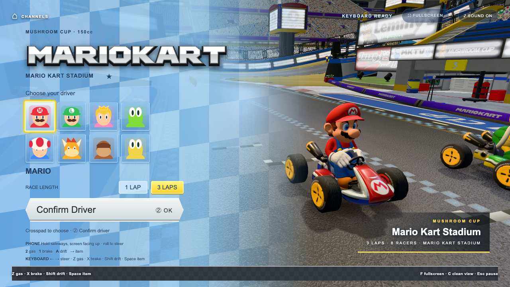
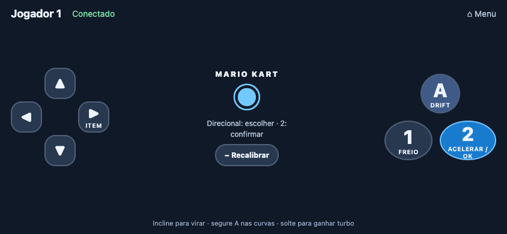
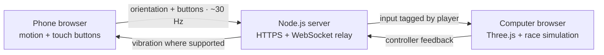

<div align="center">

# WiiPhone

### Your phone is the wheel. Your computer is the console.

Turn a QR code into a starting grid. Race in your browser, steer with your phone, and leave the extra hardware behind.

**English** · [Português brasileiro](README.pt-BR.md)

[](#the-experience)
[](#under-the-hood)
[](#the-experience)
[](LICENSE)

[Get started](#get-started) · [Controls](#controls) · [Detailed 3D pack](#detailed-3d-pack) · [Troubleshooting](#troubleshooting)

</div>



*Actual project capture with the optional 3D pack installed. A fresh clone uses the built-in procedural models until you install that pack.*

## The experience

WiiPhone connects a phone's motion sensors to a game running on your computer. Both devices use their browsers on the same Wi-Fi network: the computer renders the scene, and the phone sends steering and button input. No phone app or dedicated controller is required.

The current focus is **Mario Kart**, adapted from [pattssun/OpenWii](https://github.com/pattssun/OpenWii).

| On the track | In your hands |
| --- | --- |
| Eight selectable drivers; one human against seven CPU racers | Motion steering with neutral calibration |
| One or three laps around Mario Kart Stadium | Touch buttons for gas, brake, drift and items |
| Item boxes, coins and drift mini-turbos | Simultaneous gas and drift input |
| Antigravity sections and automatic gliding | Keyboard controls when no phone is available |
| Minimap, race position, speed and results | Reconnection and pause on controller disconnect |
| Synthesized audio and a mute toggle | Optional vibration feedback where supported |

**Player count:** the relay accepts up to four phones, but Mario Kart currently uses **Player 1 only**, racing against seven CPUs. Local multiplayer racing is not implemented.

## Get started

### 1. Start the server

You need **Node.js and npm** (the package declares Node.js `>=18`), a computer browser with **WebGL 2**, and a motion-capable phone on the **same Wi-Fi network**. Internet access is needed to install dependencies and download the optional 3D pack.

```bash
git clone https://github.com/LucasArais/WiiPhone.git
cd WiiPhone
npm install
npm start
```

Already have the project? Open a terminal in its folder and run `npm start` after installing dependencies once.

### 2. Connect your phone

1. Open **[https://localhost:8443](https://localhost:8443)** on the computer.
2. Continue past the self-signed certificate warning for your local server.
3. Scan the menu's QR code with your phone. Accept the local certificate there too.
4. Tap **Ativar sensores e conectar** (“Enable sensors and connect”) and grant motion access.
5. Open Mario Kart on the computer. Choose a driver, confirm, choose the lap count, then confirm again.
6. Hold the phone sideways and level for calibration. When the countdown ends, **hold 2 to accelerate**.

Use the QR code or the **Phone** URL printed in the terminal on your phone. `localhost` on the phone refers to the phone itself, not your computer.

The server generates its HTTPS certificate automatically. On macOS, it also attempts to open Google Chrome. Keep the terminal running while you play; **Ctrl+C** stops the server.

### Just want to try it?

Skip phone pairing and use the keyboard: **Enter** to confirm, **Z** to accelerate, and **← / →** to steer. The public procedural version runs without downloading any 3D models.

## Controls

Hold your phone sideways, screen facing mostly up, with the **directional pad on the left** and **1 / 2 on the right**. Roll it like a steering wheel.



| Action | Phone | Keyboard |
| --- | --- | --- |
| Choose driver or lap count | Directional pad | Arrow keys or mouse |
| Confirm / resume | **2** | **Enter** |
| Steer | Tilt left / right | **← / →** |
| Accelerate | Hold **2** | Hold **Z** |
| Brake / reverse | Hold **1** | Hold **X** |
| Drift | Hold **A** while turning | Hold **Shift** while turning |
| Release mini-turbo | Release **A** after charging | Release **Shift** |
| Use an item | Directional pad **→** | **Space** |
| Recenter steering | **− Recalibrar** | **R** |
| Pause / resume | Recalibrate pauses an active race; **2** resumes | **Esc** |

**F** toggles fullscreen, **C** toggles a clean view, and **I** inverts phone steering. Use the **Sound** button to mute. Returning from a disconnected controller or a hidden game tab may require **2 / Enter** to resume.

## Detailed 3D pack

The game supports two visual configurations:

| | Included in a fresh clone | Optional detailed pack |
| --- | --- | --- |
| Drivers and karts | Generated with Three.js | Eight imported drivers with kart and tires |
| Stadium | Procedurally built track and scenery | Imported Mario Kart Stadium with a measured driving surface |
| Setup | `npm install` → `npm start` | Run the asset installer with the server running |
| Files | Tracked source code and bundled artwork | Local files under `assets/mario-kart/`, ignored by Git |

To reproduce the appearance in the screenshot, install **Google Chrome** and **Python 3.9+** (`python3` must be available). Keep `npm start` running and open a second terminal in the project folder:

```bash
npm run setup:kart-assets
```

The installer downloads the eleven archives listed in [sources.json](games/mario-kart/pipeline/sources.json), verifies their SHA-256 hashes, converts the models to GLB, reconstructs the driving surface and activates the resulting manifest. Reload the game when it finishes. Downloads require the source hosts to be available.

A cloned repository does **not** contain the converted pack, even if it was installed on another machine. Missing models fall back to their procedural versions. Add `?sourceCourse=0` to the game URL to compare with the procedural track; this only changes the track, not the selected driver models.

Item images, the logo and the procedural turf texture load from the upstream GitHub repository, with bundled copies used if loading fails. Original-game fonts and audio recordings are not installed by this command; synthesized audio remains available.

See the [conversion guide](games/mario-kart/pipeline/SOURCE-ASSETS.md) for outputs, provenance and rebuild details.

## Under the hood



**Express** serves the pages and assets. **WebSocket** carries input between the phone and the game. **Three.js** renders the world; the race logic, steering calibration and audio live in separate modules. The phone does not render the race.

```text
WiiPhone/
├── server.js                    # HTTPS, QR pairing and WebSocket relay
├── public/                      # Launcher and touch controller
├── core/                        # Orientation, steering, audio and game link
├── games/mario-kart/             # Race, world, HUD, artwork and unit tests
│   └── pipeline/                # 3D converters and source records
├── scripts/setup-kart-assets.mjs # Reproducible optional pack installation
├── tests/                       # Browser race and phone integration checks
├── docs/images/                 # README screenshots
├── assets/                      # Local converted models — ignored by Git
└── test-results/                # Browser evidence — ignored by Git
```

## Development and checks

Run commands from the project root. Browser checks require **Google Chrome** and a running server.

| Command | Purpose |
| --- | --- |
| `npm start` | Start the HTTPS server |
| `npm run setup:kart-assets` | Download, convert and activate the optional 3D pack |
| `npm run test:unit` | Test race logic, steering, geometry, camera and effects |
| `npm run test:kart-browser` | Complete a keyboard-driven lap with optional assets blocked |
| `npm run test:kart-phone` | Exercise pairing, calibration, touch input and disconnect recovery |
| `KART_SOURCE=1 npm run test:kart-browser` | Require all eight imported racers and the detailed course, then race |

The race check covers driver/lap selection, acceleration, braking, pause, audio, antigravity, gliding, results and restart. Reports and screenshots go to `test-results/kart/` or `test-results/kart-source/`.

The phone check uses synthetic orientation and browser touch events through the real relay. **It does not replace testing motion sensors on a physical phone.**

### Configuration

| Variable | Default | Purpose |
| --- | --- | --- |
| `PORT` | `8443` | Server port |
| `NO_OPEN` | Unset | Set to `1` to skip opening Chrome on macOS |
| `KART_BUILD_ORIGIN` | `https://localhost:8443` | Server used by the asset converters |
| `KART_URL` | `https://localhost:8443` | Server used by browser tests |
| `KART_SOURCE` | Unset | Set to `1` for the browser test of the detailed 3D pack |

For example, in macOS/Linux shells:

```bash
PORT=8445 NO_OPEN=1 npm start
# In a second terminal:
KART_BUILD_ORIGIN=https://localhost:8445 npm run setup:kart-assets
KART_URL=https://localhost:8445 KART_SOURCE=1 npm run test:kart-browser
```

In PowerShell, set variables before the command: `$env:PORT = "8445"`, then `npm start`. Use the same `$env:NAME = "value"` syntax for the other variables.

## Troubleshooting

| Symptom | What to check |
| --- | --- |
| Phone cannot connect | Same Wi-Fi, correct computer address, Node.js allowed through the firewall, and no guest-network client isolation. |
| Certificate warning | The development server uses a self-signed certificate. Continue for your own local server on both devices. |
| Wrong address in the QR code | VPNs or multiple network adapters may change the selected IP. Use your computer's Wi-Fi IP with the configured port and `/controller.html`. |
| Steering does not respond | Allow motion access, keep the controller page visible, and make sure it is Player 1. Tap **− Recalibrar**, hold level, then resume. |
| Steering feels reversed | Press **I** on the computer. |
| Race will not start | Confirm both the driver and lap count. With a phone connected, hold it level until calibration completes. |
| Black screen or slow rendering | Check WebGL 2 and hardware acceleration. Try `?sourceCourse=0` to compare against the procedural track. |
| No sound | Click the game to unlock browser audio and check the **Sound** toggle. |
| Models look different from the screenshot | Install the optional pack with the server running, then reload. Check the installer output for download or conversion failures. |
| `EADDRINUSE` on startup | Another process uses that port. Stop an earlier server with **Ctrl+C**, or choose another `PORT`. |

## Contributing

Bug reports and focused improvements are welcome. For a reproducible issue, include your browser, operating system, phone model, whether the detailed pack is enabled, and the steps that trigger it. For visual issues, attach a screenshot.

When changing race behavior, run the relevant unit and browser checks. Document new controls in both README versions, keep source credits intact, and keep generated models, certificates and test evidence out of commits.

## Credits and license

Created by **Lucas Arais**, with Mario Kart adapted from **Patrick Sun's [OpenWii](https://github.com/pattssun/OpenWii)**. The adaptation includes race logic, procedural models and scenery, interface, effects, synthesized audio, tests and conversion tools. WiiPhone supplies its HTTPS/WebSocket relay and adapted phone controller.

- [WiiPhone software license — MIT](LICENSE)
- [Upstream license and third-party notices](THIRD_PARTY_NOTICES.md)
- [3D source pages, uploader credits and archive hashes](games/mario-kart/pipeline/sources.json)
- [Nintendo promotional item artwork sources](games/mario-kart/item-art/SOURCES.md)
- [Upstream turf texture provenance](games/mario-kart/art/README.md)

The MIT software license does not cover Nintendo artwork or models. The screenshots show those assets in the running fan project. **WiiPhone is an independent fan project, not affiliated with or endorsed by Nintendo.**
