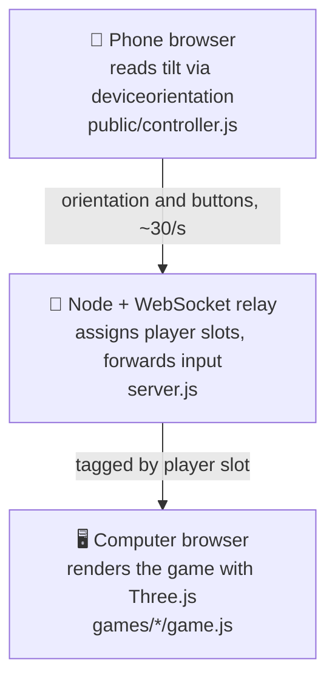

# 📱🎮 WiiPhone

**Leia em português: [README.pt-BR.md](README.pt-BR.md)**

Your phone is the controller. Your computer runs the games.

Scan a QR code to turn your phone into a motion controller — no app, no
extra hardware. Hold it flat and tilt it to steer.


## Quick start

Requires **Node.js 18+**, a computer browser with WebGL 2, and a phone
browser on the **same Wi-Fi network**.

```bash
git clone https://github.com/LucasArais/WiiPhone.git
cd WiiPhone
npm install
npm start
```

1. Open **https://localhost:8443/** on your computer.
2. Scan the QR code shown on screen with your phone's camera.
3. Accept the local self-signed certificate, tap **Ativar sensores e conectar**,
   and allow motion access when prompted.
4. Pick a game and tilt your phone to play.

**Motion sensors require HTTPS.** That's why the server generates a local
certificate automatically on first run — no manual OpenSSL step needed.

## Games

Built one at a time, game by game.

| Game | How to play | Players |
| --- | --- | --- |
| 🏎️ **[Mario Kart](games/mario-kart/README.md)** | Tilt your phone to steer. Hold 2 to accelerate, drift and use items. | 1 human + 7 CPU |

More games are on the way.

## How it works



- **`server.js`** — Express serves the static pages, generates a self-signed
  HTTPS certificate on first run (via [`selfsigned`](https://www.npmjs.com/package/selfsigned)),
  and relays WebSocket messages between phones and the game tab.
- **`public/`** — the menu (QR code + game list) and the phone controller
  page.
- **`core/`** — orientation decoding, calibrated steering, audio and game relay adapter.
- **`games/`** — one folder per game. Each game is a self-contained Three.js
  scene that reads player input from the WebSocket relay.

## Project structure

```
WiiPhone/
├── server.js              # HTTPS + WebSocket relay
├── core/
│   ├── net.js              # game adapter for the WebSocket relay
│   ├── orientation.js      # device orientation decoding
│   └── wheel-steering.js   # calibrated steering
├── public/
│   ├── menu.html/.js        # QR code + game picker
│   └── controller.html/.js  # the page the phone loads
└── games/
    └── mario-kart/
        ├── index.html
        ├── game.js          # Three.js scene, track, karts, race logic
        └── style.css
```

## Troubleshooting

- **Can't connect:** make sure both devices are on the same Wi-Fi network
  and that your firewall allows Node.js.
- **Steering doesn't move:** check that you accepted the HTTPS certificate
  warning on the phone and granted motion permission.
- **Black screen:** enable WebGL 2 / hardware acceleration in your computer
  browser.

Set `PORT` to use a different port, or `NO_OPEN=1` to skip auto-opening the
browser.

## Credits

Mario Kart is adapted from [pattssun/OpenWii](https://github.com/pattssun/OpenWii),
including its public stadium, procedural racers, race logic, HUD, item artwork
and synthesized audio. WiiPhone provides its HTTPS/WebSocket relay and adapted
phone controls. Full upstream MIT notice and artwork sources are preserved in
[THIRD_PARTY_NOTICES.md](THIRD_PARTY_NOTICES.md).

The six item images and turf texture are included locally. The original-game
models, fonts and recordings from the upstream video are not in its public
repository; this build uses the complete public procedural version.

## License

[MIT](LICENSE). This is an independent fan project and is not affiliated
with or endorsed by Nintendo.
