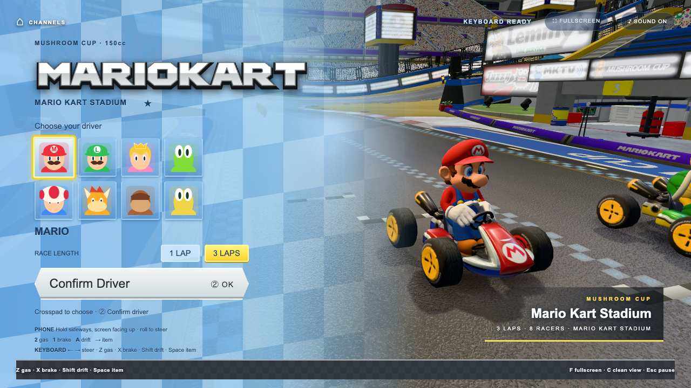
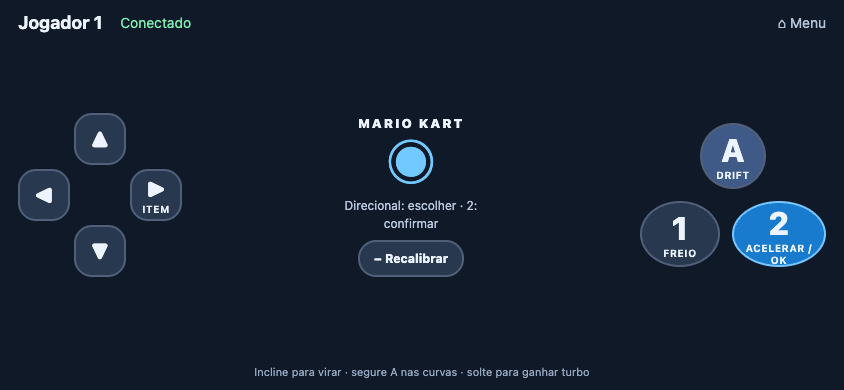
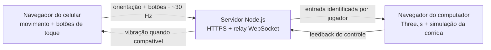

<div align="center">

# WiiPhone

### Seu celular é o volante. Seu computador é o console.

Do QR code à largada. Corra no navegador, vire com o celular e deixe o hardware extra de lado.

[English](README.md) · **Português brasileiro**

[](#a-experiência)
[](#por-dentro-do-projeto)
[](#a-experiência)
[](LICENSE)

[Começar a jogar](#começar-a-jogar) · [Controles](#controles) · [Pacote-3D detalhado](#pacote-3d-detalhado) · [Solução de problemas](#solução-de-problemas)

</div>



*Captura real do projeto com o pacote 3D opcional instalado. Um clone novo usa os modelos procedurais incluídos até você instalar esse pacote.*

## A experiência

O WiiPhone conecta os sensores de movimento do celular a um jogo rodando no computador. Os dois aparelhos usam seus navegadores na mesma rede Wi-Fi: o computador renderiza a cena, e o celular envia a direção e os botões. Sem aplicativo no celular e sem controle dedicado.

O foco atual é o **Mario Kart**, adaptado do [pattssun/OpenWii](https://github.com/pattssun/OpenWii).

| Na pista | Nas suas mãos |
| --- | --- |
| Oito pilotos selecionáveis; um humano contra sete CPUs | Direção por movimento com calibração da posição neutra |
| Uma ou três voltas no Mario Kart Stadium | Botões para acelerar, frear, derrapar e usar itens |
| Caixas de itens, moedas e mini-turbo de drift | Aceleração e drift com toques simultâneos |
| Trechos de antigravidade e planador automático | Teclado disponível quando não houver celular |
| Minimapa, posição, velocidade e resultados | Reconexão e pausa quando o controle desconecta |
| Áudio sintetizado e botão para silenciar | Vibração opcional nos dispositivos compatíveis |

**Número de jogadores:** o relay aceita até quatro celulares, mas o Mario Kart usa apenas o **Jogador 1**, contra sete CPUs. Corridas com vários jogadores humanos ainda não estão implementadas.

## Começar a jogar

### 1. Inicie o servidor

Você precisa de **Node.js e npm** (o pacote declara Node.js `>=18`), um navegador com **WebGL 2** no computador e um celular com sensores de movimento na **mesma rede Wi-Fi**. A instalação das dependências e o download do pacote 3D opcional precisam de internet.

```bash
git clone https://github.com/LucasArais/WiiPhone.git
cd WiiPhone
npm install
npm start
```

Já tem o projeto? Abra o terminal na pasta dele e execute `npm start`, depois de instalar as dependências uma vez.

### 2. Conecte o celular

1. Abra **[https://localhost:8443](https://localhost:8443)** no computador.
2. Continue após o aviso do certificado autoassinado do seu servidor local.
3. Escaneie o QR code do menu com o celular. Aceite o certificado local nele também.
4. Toque em **Ativar sensores e conectar** e permita o acesso aos sensores.
5. Abra o Mario Kart no computador. Escolha um piloto, confirme, selecione o número de voltas e confirme novamente.
6. Segure o celular de lado e nivelado para calibrar. Quando a contagem terminar, **segure 2 para acelerar**.

No celular, use o QR code ou o endereço **Phone** exibido no terminal. `localhost` no celular aponta para o próprio celular, não para o computador.

O servidor gera o certificado HTTPS automaticamente. No macOS, também tenta abrir o Google Chrome. Mantenha o terminal aberto durante a partida; **Ctrl+C** encerra o servidor.

### Quer experimentar agora?

Pule o pareamento e use o teclado: **Enter** para confirmar, **Z** para acelerar e **← / →** para virar. A versão procedural pública funciona sem baixar nenhum modelo 3D.

## Controles

Segure o celular de lado, com a tela voltada principalmente para cima, o **direcional à esquerda** e os botões **1 / 2 à direita**. Incline como se estivesse girando um volante.



| Ação | Celular | Teclado |
| --- | --- | --- |
| Escolher piloto ou voltas | Direcional | Setas ou mouse |
| Confirmar / continuar | **2** | **Enter** |
| Virar | Inclinar para os lados | **← / →** |
| Acelerar | Segurar **2** | Segurar **Z** |
| Frear / dar ré | Segurar **1** | Segurar **X** |
| Drift | Segurar **A** durante a curva | Segurar **Shift** durante a curva |
| Liberar mini-turbo | Soltar **A** após carregar | Soltar **Shift** |
| Usar item | Direcional **→** | **Espaço** |
| Recalibrar direção | **− Recalibrar** | **R** |
| Pausar / continuar | Recalibrar pausa a corrida; **2** continua | **Esc** |

**F** alterna tela cheia, **C** alterna a visualização sem interface e **I** inverte a direção do celular. Use **Sound** para silenciar. Depois de desconectar o controle ou ocultar a aba do jogo, pode ser necessário pressionar **2 / Enter** para continuar.

## Pacote 3D detalhado

O jogo oferece duas configurações visuais:

| | Incluído em um clone novo | Pacote detalhado opcional |
| --- | --- | --- |
| Pilotos e karts | Gerados com Three.js | Oito pilotos importados com kart e pneus |
| Estádio | Pista e cenário construídos proceduralmente | Mario Kart Stadium importado com superfície de corrida medida |
| Instalação | `npm install` → `npm start` | Executar o instalador de assets com o servidor rodando |
| Arquivos | Código e imagens versionados | Arquivos locais em `assets/mario-kart/`, ignorados pelo Git |

Para reproduzir o visual da captura, instale **Google Chrome** e **Python 3.9+** (o comando `python3` precisa estar disponível). Deixe `npm start` rodando e abra outro terminal na pasta do projeto:

```bash
npm run setup:kart-assets
```

O instalador baixa os onze arquivos listados em [sources.json](games/mario-kart/pipeline/sources.json), verifica seus hashes SHA-256, converte os modelos para GLB, reconstrói a superfície da pista e ativa o manifesto resultante. Recarregue o jogo ao terminar. Os downloads dependem da disponibilidade dos sites de origem.

Um clone do repositório **não** contém o pacote convertido, mesmo que ele já tenha sido instalado em outra máquina. Modelos ausentes usam suas versões procedurais. Acrescente `?sourceCourse=0` à URL do jogo para comparar com a pista procedural; isso muda apenas a pista, não os modelos dos pilotos selecionados.

As imagens dos itens, o logo e a textura de grama da pista procedural carregam do GitHub de referência, com cópias locais caso o carregamento falhe. O comando não instala fontes tipográficas nem gravações do jogo original; o áudio sintetizado continua disponível.

Consulte o [guia de conversão](games/mario-kart/pipeline/SOURCE-ASSETS.md) para conhecer os arquivos gerados, a procedência e o processo de reconstrução.

## Por dentro do projeto



O **Express** serve as páginas e os arquivos. O **WebSocket** transporta os comandos entre celular e jogo. O **Three.js** renderiza o mundo; a lógica da corrida, a calibração da direção e o áudio ficam em módulos separados. O celular não renderiza a corrida.

```text
WiiPhone/
├── server.js                    # HTTPS, pareamento por QR e relay WebSocket
├── public/                      # Menu e controle de toque
├── core/                        # Orientação, direção, áudio e conexão do jogo
├── games/mario-kart/             # Corrida, mundo, HUD, imagens e testes unitários
│   └── pipeline/                # Conversores 3D e registros de origem
├── scripts/setup-kart-assets.mjs # Instalação reproduzível do pacote opcional
├── tests/                       # Testes de corrida e controle no navegador
├── docs/images/                 # Capturas usadas no README
├── assets/                      # Modelos convertidos locais — fora do Git
└── test-results/                # Evidências do navegador — fora do Git
```

## Desenvolvimento e verificações

Execute os comandos na raiz do projeto. Os testes de navegador exigem **Google Chrome** e o servidor rodando.

| Comando | Finalidade |
| --- | --- |
| `npm start` | Iniciar o servidor HTTPS |
| `npm run setup:kart-assets` | Baixar, converter e ativar o pacote 3D opcional |
| `npm run test:unit` | Testar corrida, direção, geometria, câmera e efeitos |
| `npm run test:kart-browser` | Completar uma volta pelo teclado com os assets opcionais bloqueados |
| `npm run test:kart-phone` | Verificar pareamento, calibração, toque e recuperação após desconectar |
| `KART_SOURCE=1 npm run test:kart-browser` | Exigir os oito pilotos importados e a pista detalhada, depois correr |

O teste de corrida cobre seleção de piloto e voltas, aceleração, freio, pausa, áudio, antigravidade, planador, resultados e reinício. Relatórios e capturas ficam em `test-results/kart/` ou `test-results/kart-source/`.

O teste do controle usa orientação simulada e eventos de toque do navegador pelo relay real. **Ele não substitui o teste dos sensores em um celular físico.**

### Configuração

| Variável | Padrão | Finalidade |
| --- | --- | --- |
| `PORT` | `8443` | Porta do servidor |
| `NO_OPEN` | Não definida | Use `1` para não abrir o Chrome no macOS |
| `KART_BUILD_ORIGIN` | `https://localhost:8443` | Servidor usado pelos conversores de assets |
| `KART_URL` | `https://localhost:8443` | Servidor usado pelos testes de navegador |
| `KART_SOURCE` | Não definida | Use `1` para testar o pacote 3D detalhado no navegador |

Exemplo em terminais macOS/Linux:

```bash
PORT=8445 NO_OPEN=1 npm start
# Em outro terminal:
KART_BUILD_ORIGIN=https://localhost:8445 npm run setup:kart-assets
KART_URL=https://localhost:8445 KART_SOURCE=1 npm run test:kart-browser
```

No PowerShell, defina a variável antes do comando: `$env:PORT = "8445"`, depois `npm start`. Use a mesma sintaxe `$env:NOME = "valor"` para as outras variáveis.

## Solução de problemas

| Sintoma | O que conferir |
| --- | --- |
| O celular não conecta | Mesma rede Wi-Fi, endereço correto do computador, Node.js liberado no firewall e ausência de isolamento entre clientes na rede de convidados. |
| Aviso de certificado | O servidor de desenvolvimento usa certificado autoassinado. Continue para o seu próprio servidor local nos dois aparelhos. |
| Endereço errado no QR code | VPNs e múltiplos adaptadores podem alterar o IP escolhido. Use o IP Wi-Fi do computador com a porta configurada e `/controller.html`. |
| A direção não responde | Permita acesso aos sensores, mantenha a página do controle visível e confira se é o Jogador 1. Toque em **− Recalibrar**, nivele o celular e continue. |
| A direção está invertida | Pressione **I** no computador. |
| A corrida não começa | Confirme o piloto e o número de voltas. Com celular conectado, mantenha-o nivelado até terminar a calibração. |
| Tela preta ou renderização lenta | Confira WebGL 2 e aceleração de hardware. Experimente `?sourceCourse=0` para comparar com a pista procedural. |
| Sem som | Clique no jogo para liberar o áudio do navegador e confira o botão **Sound**. |
| Os modelos diferem da captura | Instale o pacote opcional com o servidor rodando e recarregue. Confira a saída do instalador para identificar falhas de download ou conversão. |
| `EADDRINUSE` ao iniciar | Outro processo usa a porta. Encerre um servidor anterior com **Ctrl+C** ou escolha outra `PORT`. |

## Como contribuir

Relatos de problemas e melhorias focadas são bem-vindos. Para reproduzir um problema, informe navegador, sistema operacional, modelo do celular, uso ou não do pacote detalhado e os passos que causam a falha. Para problemas visuais, inclua uma captura de tela.

Ao alterar o comportamento da corrida, execute os testes unitários e de navegador pertinentes. Documente novos controles nas duas versões do README, preserve os créditos e mantenha modelos gerados, certificados e evidências de teste fora dos commits.

## Créditos e licença

Criado por **Lucas Arais**, com o Mario Kart adaptado do **[OpenWii](https://github.com/pattssun/OpenWii), de Patrick Sun**. A adaptação inclui lógica de corrida, modelos e cenário procedurais, interface, efeitos, áudio sintetizado, testes e ferramentas de conversão. O WiiPhone fornece seu relay HTTPS/WebSocket e o controle de celular adaptado.

- [Licença do software WiiPhone — MIT](LICENSE)
- [Licença original e avisos de terceiros](THIRD_PARTY_NOTICES.md)
- [Fontes 3D, créditos dos responsáveis pelos uploads e hashes dos arquivos](games/mario-kart/pipeline/sources.json)
- [Fontes das imagens promocionais dos itens da Nintendo](games/mario-kart/item-art/SOURCES.md)
- [Procedência da textura de grama da referência](games/mario-kart/art/README.md)

A licença MIT do software não cobre as imagens ou os modelos da Nintendo. As capturas mostram esses assets no projeto de fã em execução. **O WiiPhone é um projeto de fã independente, sem afiliação ou endosso da Nintendo.**
