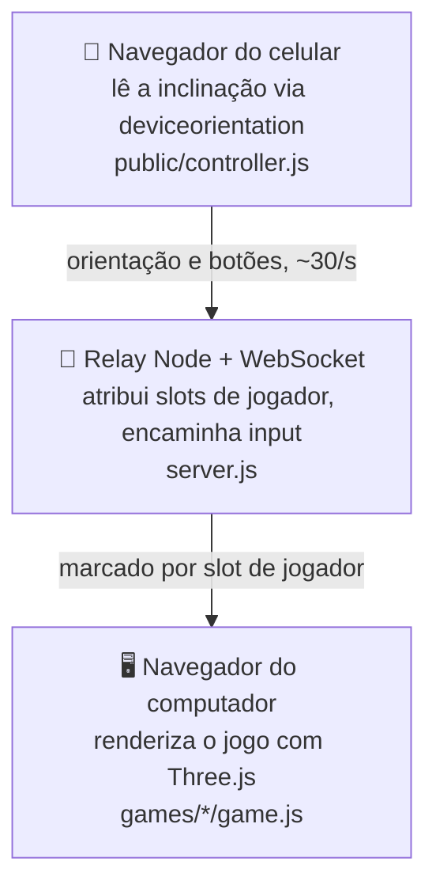

# 📱🎮 WiiPhone

**Read in English: [README.md](README.md)**

Seu celular é o controle. Seu computador roda os jogos.

Escaneie um QR code para transformar o celular em um controle por
movimento — sem aplicativo, sem hardware extra. Basta segurar na horizontal
e inclinar para virar.


## Começando

Requer **Node.js 18+**, um navegador com WebGL 2 no computador, e um
navegador no celular na **mesma rede Wi-Fi**.

```bash
git clone https://github.com/LucasArais/WiiPhone.git
cd WiiPhone
npm install
npm start
```

1. Abra **https://localhost:8443/** no computador.
2. Escaneie o QR code exibido na tela com a câmera do celular.
3. Aceite o certificado local autoassinado, toque em **Ativar sensores e conectar** e permita o acesso aos sensores de movimento.
4. Escolha um jogo e incline o celular para jogar.

**Sensores de movimento exigem HTTPS.** Por isso o servidor gera um
certificado local automaticamente na primeira execução — sem precisar
configurar OpenSSL manualmente.

## Jogos

Construído aos poucos, um jogo por vez.

| Jogo | Como jogar | Jogadores |
| --- | --- | --- |
| 🏎️ **[Mario Kart](games/mario-kart/README.md)** | Incline o celular para virar. Segure 2 para acelerar, derrape e use itens. | 1 humano + 7 CPU |

Mais jogos estão a caminho.

## Como funciona



- **`server.js`** — Express serve as páginas estáticas, gera um certificado
  HTTPS autoassinado na primeira execução (via [`selfsigned`](https://www.npmjs.com/package/selfsigned))
  e faz o relay das mensagens WebSocket entre os celulares e a aba do jogo.
- **`public/`** — o menu (QR code + lista de jogos) e a página do
  controlador no celular.
- **`core/`** — orientação, direção calibrada, áudio e adaptação do relay para o jogo.
- **`games/`** — uma pasta por jogo. Cada jogo é uma cena Three.js
  independente que lê o input dos jogadores via relay WebSocket.

## Estrutura do projeto

```
WiiPhone/
├── server.js              # HTTPS + relay WebSocket
├── core/
│   ├── net.js              # adaptação do relay para o jogo
│   ├── orientation.js      # orientação do celular
│   └── wheel-steering.js   # direção calibrada
├── public/
│   ├── menu.html/.js        # QR code + seletor de jogos
│   └── controller.html/.js  # a página que o celular carrega
└── games/
    └── mario-kart/
        ├── index.html
        ├── game.js          # cena Three.js, pista, karts, lógica de corrida
        └── style.css
```

## Solução de problemas

- **Não conecta:** confira se os dois aparelhos estão na mesma rede Wi-Fi e
  se o firewall permite o Node.js.
- **A direção não responde:** confirme que aceitou o aviso de certificado
  HTTPS no celular e concedeu permissão de movimento.
- **Tela preta:** ative WebGL 2 / aceleração de hardware no navegador do
  computador.

Use `PORT` para escolher outra porta, ou `NO_OPEN=1` para não abrir o
navegador automaticamente.

## Créditos

O Mario Kart foi adaptado do [pattssun/OpenWii](https://github.com/pattssun/OpenWii),
incluindo estádio, pilotos procedurais, lógica de corrida, interface, imagens de
itens e áudio sintetizado da versão pública. O WiiPhone mantém seu servidor
HTTPS/WebSocket e adapta o controle do celular. A licença MIT original e as
fontes das imagens estão em [THIRD_PARTY_NOTICES.md](THIRD_PARTY_NOTICES.md).

As seis imagens dos itens e a textura de grama estão incluídas localmente.
Os modelos, fontes e gravações do jogo original usados no vídeo da referência
não estão no repositório público; esta versão usa os modelos procedurais dele.

## Licença

[MIT](LICENSE). Este é um projeto de fã independente, sem afiliação ou
endosso da Nintendo.
